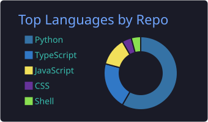
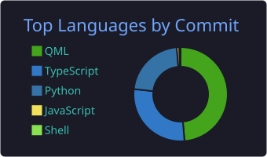

 

  

  

<!-- Профиль: карточки из GitHub Actions -->

  

<!-- Языки и 3D-календарь (lowlighter/metrics) -->

  

<!-- Змейка -->
<picture>
  <source media="(prefers-color-scheme: dark)" srcset="https://raw.githubusercontent.com/khamidullaevv/khamidullaevv/output/github-contribution-grid-snake-dark.svg" />
  <source media="(prefers-color-scheme: light)" srcset="https://raw.githubusercontent.com/khamidullaevv/khamidullaevv/output/github-contribution-grid-snake.svg" />
  
</picture>

  

